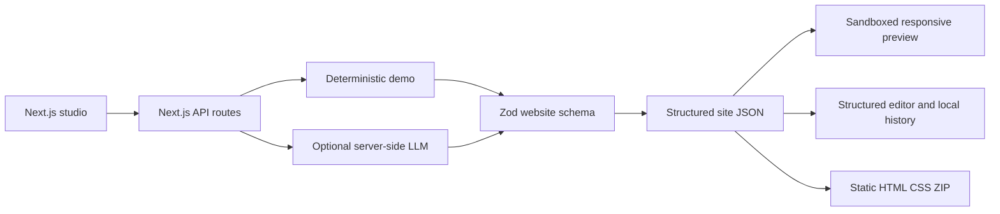

<div align="center">

# AI Website Generator 🪄

**Crea sitios web adaptables y editables mediante prompts estructurados y seguros.**

[🇺🇸 English](README.md) · [🇧🇷 Português](README.pt-BR.md) · [🇪🇸 Español](README.es.md)

[](https://github.com/RamonRDR/ai-website-generator/actions/workflows/ci.yml)
[](https://nodejs.org/)
[](https://www.typescriptlang.org/)
[](LICENSE)

[](https://nextjs.org/)
[](https://react.dev/)
[](https://zod.dev/)
[](https://stuk.github.io/jszip/)
[](docs/SECURITY.md)

[](https://vitest.dev/)
[](https://playwright.dev/)
[](https://testing-library.com/docs/react-testing-library/intro/)
[](https://github.com/testing-library/jest-dom)
[](https://eslint.org/)
[](https://prettier.io/)
[](tsconfig.json)
[](https://github.com/RamonRDR/ai-website-generator/actions/runs/42848221159)
[](docs/EVALUATION.md)
[](https://vite.dev/)
[](https://github.com/jsdom/jsdom)
[](https://github.com/vitejs/vite-plugin-react)

[](docs/EXPORT.md)
[](docs/architecture.md)
[](docs/SECURITY.md)

</div>

> **Estado del proyecto:** MVP implementado en [PR #1](https://github.com/RamonRDR/ai-website-generator/pull/1) (abierto para revisión, sin fusión). La ejecución de referencia [42848221159](https://github.com/RamonRDR/ai-website-generator/actions/runs/42848221159) pasó. El badge CI sigue la rama de desarrollo hasta la fusión. Los cinco problemas identificados en dos revisiones de Codex se corrigieron y probaron; queda pendiente una nueva revisión. No hubo despliegue.

## Descripción general

Studio desarrollado con Next.js y TypeScript estricto para crear sitios a partir de instrucciones en lenguaje natural. Las páginas son **estructuras de datos validadas**, no código ejecutable producido por un LLM. Demuestra frontend, renderización segura, IA aplicada opcional, pruebas y exportación estática.

**El modo demo utiliza plantillas deterministas, no un modelo de IA real.** El adaptador de IA en vivo es opcional y no se ha verificado mediante solicitudes pagadas.

## Funcionalidades implementadas

- Siete categorías: empresas, portafolios, institucional, productos, servicios, eventos y restaurantes.
- Campos para prompt, nombre del proyecto, público, objetivo, idioma, categoría y tema visual.
- Cuatro temas: Ocean, Sunset, Forest y Mono, con colores hexadecimales válidos y editables.
- Schema Zod versionado y once secciones permitidas: `header`, `hero`, `features`, `about`, `services`, `pricing`, `testimonials`, `faq`, `cta`, `contact` y `footer`.
- Renderer HTML seguro y adaptable, con metadatos y vista previa desktop/móvil (390 px) en un iframe aislado.
- Editor por formularios de títulos, descripciones, botones, enlaces, tarjetas, imágenes permitidas, visibilidad, inserción, eliminación y orden de secciones.
- Regeneración limitada a la sección seleccionada, con vista previa y aceptación o rechazo explícito.
- Hasta 15 puntos de versión locales, restauración y comparación básica con la última versión guardada.
- ZIP estático que contiene `index.html`, `styles.css`, `metadata.json` y `README.md` de exportación.
- Adaptador de chat completions de OpenAI opcional, desactivado por defecto y sin validación en vivo afirmada.

## Tecnologías

**Entorno:** Node.js >=22.12.0; CI utiliza Node.js **24**. **Aplicación:** Next.js **16.4.5**, React **19.3.1**, TypeScript **5.9.3** (estricto), Zod **4.6.7** y JSZip **3.10.2**. **Pruebas:** Vitest **3.2.7**, Playwright **1.65.0**, React Testing Library **16.3.3**, jest-dom **6.9.1**, Vite **7.3.7**, Vite React plugin **5.2.0** y jsdom **27.4.0**. **Calidad:** ESLint **9.39.5**, Prettier **3.9.10** y GitHub Actions.

Las versiones proceden de `package-lock.json`, no de estimaciones de intervalos en `package.json`. No incluye Tailwind CSS, base de datos, Redis, Docker, servidor MCP ni despliegue en la nube.

## Arquitectura



`src/domain/schema.ts` define el límite de confianza. `src/domain/render.ts` escapa contenido y genera un diseño fijo. El iframe no permite scripts. `src/domain/export.ts` solo emite nombres de archivos fijos; `src/domain/storage.ts` valida los sitios guardados. El proveedor LLM opcional está aislado en `src/server/provider.ts`. Más detalles: [arquitectura](docs/architecture.md) y [decisiones técnicas](docs/DECISIONS.md).

## Requisitos previos

Node.js **22.12+**, npm y un navegador moderno. GitHub Actions usa Node 24. El modo demo no necesita base de datos, backend separado, cuenta en la nube ni clave de API de pago.

## Instalación y configuración

```bash
git clone https://github.com/RamonRDR/ai-website-generator.git
cd ai-website-generator
npm ci
cp .env.example .env.local
npm run dev
```

El archivo de entorno de ejemplo es seguro para el modo demo. En Windows PowerShell puedes utilizar `Copy-Item .env.example .env.local` en lugar de `cp`. Para habilitar voluntariamente el adaptador en vivo, potencialmente pagado, configura las variables **solo en el servidor privado**:

```dotenv
LLM_ENABLED=true
LLM_API_KEY=your_private_server_key
LLM_MODEL=your_supported_json_schema_model
```

Las solicitudes usan el endpoint HTTPS oficial y fijo de chat completions de OpenAI y requieren un modelo compatible con `json_schema`. En producción también se exige `LLM_ALLOW_PRODUCTION=true`. **No habilites generación pagada públicamente sin autenticación, cuotas y rate limiting**; el MVP no incluye esas defensas.

## Ejecución y ejemplo

Después de `npm run dev`, abre `http://localhost:3000`. Selecciona **Demo · Free, deterministic**, escribe el nombre y la descripción, elige categoría/tema y pulsa **Generate website**. Cambia entre Desktop/Mobile, edita secciones, guarda versiones, propone cambios, acepta o rechaza, restaura una versión y exporta el ZIP.

Prompt de ejemplo: “Crea un portafolio minimalista para un desarrollador web independiente, con servicios y contacto destacado.” El modo demo usa contenido determinista por categoría, **no generación semántica con IA real**. Más ejemplos: [biblioteca de prompts](docs/PROMPTS.md).

## Interfaz web y rutas API

- `GET /`: interfaz adaptable de Studio.
- `GET /api/health`: respuesta simple de estado de la aplicación (no comprueba base de datos).
- `POST /api/generate`: generación validada en demo o mediante el adaptador en vivo explícitamente habilitado.
- `POST /api/regenerate`: propuesta validada para regenerar la sección seleccionada.

La API es interna a la aplicación. **No hay OpenAPI/Swagger UI**, autenticación SaaS pública ni servicio de API publicado externamente. Consulta los [schemas](docs/SCHEMA.md).

## Pruebas automatizadas

```bash
npm run lint
npm run typecheck
npm test
npm run evaluate
npm run build
npm run format:check
npx playwright install chromium
npm run test:e2e
```

**Verificado en la ejecución [42848221159](https://github.com/RamonRDR/ai-website-generator/actions/runs/42848221159):** 35/35 pruebas Vitest aprobadas en 9 archivos; 8/8 pruebas Playwright E2E aprobadas; **0 fallos y 0 omitidas**. `npm run evaluate` vuelve a ejecutar **una** prueba ya incluida en las 35. Esa prueba valida **20 escenarios sintéticos deterministas**, no 20 pruebas adicionales ni la precisión de un LLM real.

Los recuentos son una **instantánea del CI**, no un contador automático. Si cambian las pruebas, actualiza las cifras en los tres READMEs y en el [inventario de badges](docs/BADGES.md) a partir de una ejecución satisfactoria. No declares cobertura sin medirla.

## GitHub Actions

`.github/workflows/ci.yml` utiliza runners Ubuntu de GitHub con permisos de lectura. El job de calidad ejecuta ESLint, TypeScript estricto, Vitest, evaluación determinista, build de Next.js y Prettier; el job de navegador ejecuta Playwright/Chromium. La instalación usa `npm ci` y el lockfile. No requiere equipo personal, API pagada, despliegue ni fusión automática.

## Seguridad

Schemas Zod estrictos limitan tipos de componentes, URLs, imágenes, textos, colores y longitud de prompts. Se escapa HTML; no se ejecutan scripts/JSX ni HTML arbitrario generado por IA; el iframe está aislado; las claves permanecen en el servidor; y los nombres de archivos ZIP no dependen de entradas del usuario. Las respuestas inválidas se rechazan. Detalles: [modelo de seguridad](docs/SECURITY.md).

## Limitaciones conocidas

El modo demo utiliza plantillas; la operación pagada de LLM real **no ha sido verificada**. No hay editor drag-and-drop, sincronización entre dispositivos, colaboración, autenticación, límites públicos de solicitudes, base de datos, pagos ni despliegue. El ZIP contiene HTML/CSS estático y no un proyecto Next.js completo. Es necesaria revisión humana de datos, derechos de imágenes, accesibilidad y SEO. No se afirma certificación WCAG, cobertura de código medida, capturas reales ni URL de producción.

## Estructura del repositorio

- `app/`: aplicación Next.js, interfaz Studio y rutas API.
- `src/domain/`: schemas, temas, demo, renderer, versiones y exportación.
- `src/server/`: adaptador de IA opcional en el servidor.
- `src/ui/`: edición adaptable y vista previa.
- `tests/` y `e2e/`: pruebas unitarias/de componentes, evaluación determinista y E2E Chromium.
- `docs/`: arquitectura, schemas, seguridad, pruebas, evaluación, decisiones y evidencias de los badges.
- `.github/workflows/ci.yml`: comprobaciones automáticas sin despliegue.

## Mejoras futuras posibles

Como evoluciones opcionales: evaluación autorizada de proveedor real, auditorías de accesibilidad, autenticación y rate limiting antes de exponer IA pagada, importación de proyectos editables y editor visual más avanzado. **Ninguna de ellas se anuncia como implementada.**

## Contribuciones

Se aceptan issues y pull requests enfocados. Antes de contribuir, ejecuta las comprobaciones y conserva el modelo de renderización estructurada y segura. El proyecto está en revisión en [PR #1](https://github.com/RamonRDR/ai-website-generator/pull/1); la rama `main` solo se actualizará con autorización del propietario.

## Documentación

[architecture](docs/architecture.md) · [schemas](docs/SCHEMA.md) · [security](docs/SECURITY.md) · [tests](docs/TESTING.md) · [evaluation](docs/EVALUATION.md) · [prompt examples](docs/PROMPTS.md) · [export](docs/EXPORT.md) · [decisions](docs/DECISIONS.md) · [badge inventory](docs/BADGES.md)

## Licencia

[Licencia MIT](LICENSE) © 2026 Ramon Rodriguez.
