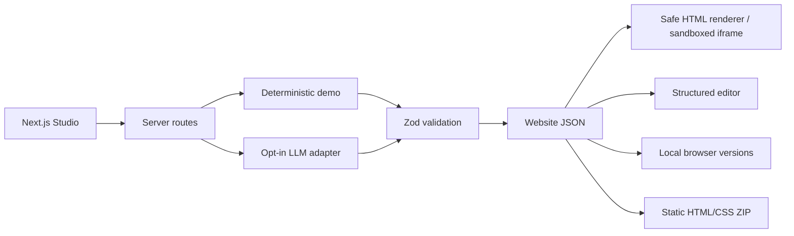

# AI Website Generator

[](https://github.com/RamonRDR/ai-website-generator/actions/workflows/ci.yml)
[](LICENSE)

A Next.js and TypeScript website studio that turns natural-language requirements into **validated, responsive page structures**. Generate a website, preview desktop or mobile, edit components, save local versions, propose a scoped regeneration, and export a static ZIP. Designed as a small, auditable full-stack and applied-AI portfolio project.

> **Important:** Demo mode uses deterministic templates, not a language model. Optional live AI uses an explicitly configured provider. No deployment or paid API calls are needed to run the standard test suite.

## What works

| Feature | Approach |
| --- | --- |
| Natural-language input | Prompt, category, project name, audience, goal, theme, language |
| Website categories | Business, portfolio, institutional, product, services, event, restaurant |
| Structured generation | Versioned Zod website schema, bounded text and allowlisted sections |
| Built-in themes | Ocean, Sunset, Forest, Mono; editable safe hex palette |
| Responsive preview | Sandboxed iframe; desktop and 390px mobile |
| Visual editing | Headings, descriptions, actions, cards, visibility, ordering, adding/removing sections |
| Scoped regeneration | Candidate changes limited to selected section; accept or reject |
| Version history | Local browser storage, capped at 15 checkpoints, manual restore |
| Export | Standalone HTML, CSS, metadata and instructions packed as ZIP |
| Optional live LLM | Server-only OpenAI-compatible chat completions with JSON schema output, then Zod validation |
| Quality | Vitest, React Testing Library, Playwright, 20 synthetic evaluation prompts, GitHub Actions |

The renderer does not evaluate arbitrary JavaScript, dynamic JSX, user HTML, or model-generated CSS.

## Quick start

Prerequisites: Node.js 22.12+ (Node 24 recommended), npm.

```bash
git clone https://github.com/RamonRDR/ai-website-generator.git
cd ai-website-generator
npm install
cp .env.example .env.local
npm run dev
```

Open http://localhost:3000. Choose **Demo · Free, deterministic** and click **Generate website**.

For production-like verification:

```bash
npm run lint
npm run typecheck
npm test
npm run evaluate
npm run build
npx playwright install chromium
npm run test:e2e
npm run format:check
```

Playwright launches a local server automatically. The app has no separate database or backend process.

## Optional live AI (costs may apply)

All live calls are **disabled** by default. Set the following in your **server-only** `.env.local` if you intentionally want to test live generation:

```dotenv
LLM_ENABLED=true
LLM_API_KEY=your_private_server_key
LLM_MODEL=your_supported_model
```

The initial adapter targets the official OpenAI chat completions endpoint over HTTPS. A model compatible with `json_schema` responses is required. The API credential is never exposed via `NEXT_PUBLIC_*` or sent to the browser. Live mode remains disabled in production unless `LLM_ALLOW_PRODUCTION=true` is explicitly set. **This MVP has no authentication or public API rate limiting: do not enable paid generation on a public deployment without adding authentication, quotas and rate limiting.** The adapter makes a single bounded request, with a 20-second timeout and token cap; it does not retry automatically.

No live provider calls occur in unit tests, browser tests, builds or CI.

## Typical workflow

1. Describe the site and choose category, theme and language.
2. Generate a deterministic draft (or choose configured live AI).
3. Inspect the sandboxed preview in desktop and mobile modes.
4. Select a section, edit texts, buttons, cards and theme colors.
5. Add, hide, reorder or remove components.
6. Save checkpoints. Restore a version from history when needed.
7. Request a scoped change and accept or reject the candidate after previewing it.
8. Export `website-export.zip`, extract it and open `index.html` locally.

## Architecture



`src/domain/schema.ts` is the single source of truth for website data. `src/domain/render.ts` produces escaped HTML and constrained CSS variables; the iframe is sandboxed with no script permission. `src/domain/export.ts` reuses the renderer and produces a fixed file list, so user input cannot select paths.

## Component catalog

`header`, `hero`, `features`, `about`, `services`, `pricing`, `testimonials`, `faq`, `cta`, `contact`, `footer`.

All components have bounded text, optional safe buttons and cards. Only HTTPS images from the explicitly approved hosts can be stored. Demo templates use placeholders rather than invented business facts, reviews, phone numbers or addresses.

## Validation and security

Prompt length is limited, unknown schema keys are rejected, section types are allowlisted, all URLs are validated, colors must be hex, HTML special characters are escaped, and generated scripts are never run. The server treats LLM output as untrusted data, applies Zod validation and enforces selected-section-only regeneration. API requests have size caps. Errors are returned without logging credentials or raw provider responses. Generated content is not auto-published.

See [security model](docs/SECURITY.md), [schema reference](docs/SCHEMA.md), [architecture](docs/architecture.md) and [decisions](docs/DECISIONS.md).

## Tests and evaluation

Vitest covers schema validity, link and injection defenses, deterministic generation, isolated regeneration, safe renderer, ZIP integrity, local history and provider opt-in. React Testing Library covers Studio behavior; Playwright covers main browser flows. The 20 synthetic prompts are deterministic regression fixtures, not evidence of live model accuracy. CI runs on GitHub-hosted runners and requires no paid credentials. Actual check status is displayed by the badge above.

See [testing guide](docs/TESTING.md) and [evaluation method](docs/EVALUATION.md).

## Documentation

- [Prompt examples](docs/PROMPTS.md)
- [Export instructions](docs/EXPORT.md)
- [Schema catalog](docs/SCHEMA.md)
- [Architecture](docs/architecture.md)
- [Technical decisions](docs/DECISIONS.md)
- [Security](docs/SECURITY.md)
- [Testing](docs/TESTING.md)
- [Evaluation](docs/EVALUATION.md)
- [README em português](README.pt-BR.md)
- [README en español](README.es.md)

## Known limitations

This is an intentionally bounded MVP, not a clone of commercial code-generation products. Demo mode is template-based; live results depend on a user-provided paid API and schema-capable model. The output is a static HTML/CSS site, not a deployed React/Next.js application. The editor uses structured controls rather than drag-and-drop. History is local to one browser and is not cross-device synced. Generated facts, accessibility and SEO require human review before publishing. There is no authentication, billing, collaboration or automatic deployment. Screenshots and live deployment URLs are intentionally omitted until they genuinely exist.

## License

[MIT](LICENSE) © 2026 Ramon Rodriguez.
