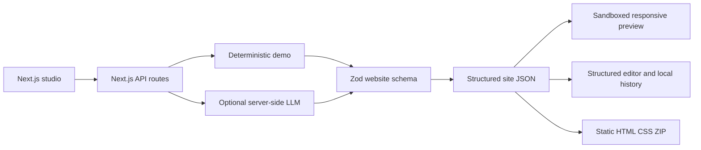

<div align="center">

# AI Website Generator 🪄

**Build responsive, editable websites from structured prompts, safely.**

[🇺🇸 English](README.md) · [🇧🇷 Português](README.pt-BR.md) · [🇪🇸 Español](README.es.md)

[](https://github.com/RamonRDR/ai-website-generator/actions/workflows/ci.yml)
[](https://nodejs.org/)
[](https://www.typescriptlang.org/)
[](LICENSE)

[](https://nextjs.org/)
[](https://react.dev/)
[](https://zod.dev/)
[](https://stuk.github.io/jszip/)
[](docs/SECURITY.md)

[](https://vitest.dev/)
[](https://playwright.dev/)
[](https://testing-library.com/docs/react-testing-library/intro/)
[](https://github.com/testing-library/jest-dom)
[](https://eslint.org/)
[](https://prettier.io/)
[](tsconfig.json)
[](https://github.com/RamonRDR/ai-website-generator/actions/runs/42505766780)
[](docs/EVALUATION.md)
[](https://vite.dev/)
[](https://github.com/jsdom/jsdom)
[](https://github.com/vitejs/vite-plugin-react)

[](docs/EXPORT.md)
[](docs/architecture.md)
[](docs/SECURITY.md)

</div>

> **Project status:** MVP implemented on [PR #1](https://github.com/RamonRDR/ai-website-generator/pull/1) (draft, not merged). The reference CI run [42505766780](https://github.com/RamonRDR/ai-website-generator/actions/runs/42505766780) passed. The CI badge above tracks the feature branch until merge. No Codex review or deployment has been performed.

## Overview

A Next.js and strict-TypeScript studio for creating websites from natural-language requirements. Pages are **validated data structures**, not executable code generated by an LLM. It demonstrates frontend development, secure rendering, optional applied AI, automated tests and static export.

**Demo mode uses deterministic templates, not a real AI model.** Live AI is an opt-in server-side adapter and has not been verified with paid provider requests.

## Implemented features

- Seven website categories: business, portfolio, institutional, product, services, event and restaurant.
- Input fields for prompt, project name, audience, goal, language, website category and visual theme.
- Four visual themes: Ocean, Sunset, Forest and Mono, with validated, editable hexadecimal colors.
- Versioned Zod schema and eleven allowed sections: `header`, `hero`, `features`, `about`, `services`, `pricing`, `testimonials`, `faq`, `cta`, `contact` and `footer`.
- Safe HTML renderer with responsive layout, descriptive metadata and a sandboxed desktop/mobile (390 px) iframe.
- Form-based editor for headings, descriptions, buttons, links, cards, approved images, visibility, section insertion, removal and reordering.
- Section-scoped regeneration with candidate preview and explicit acceptance or rejection.
- Up to 15 local browser history checkpoints, restore operation and a basic comparison against the latest checkpoint.
- Static ZIP containing `index.html`, `styles.css`, `metadata.json` and an export `README.md`.
- Optional OpenAI chat-completions adapter, disabled by default and not claimed as a verified live integration.

## Technology stack

**Runtime:** Node.js >=22.12.0; the CI runner uses Node.js **24**. **Application:** Next.js **16.4.5**, React **19.3.1**, TypeScript **5.9.3** (strict), Zod **4.6.7** and JSZip **3.10.2**. **Testing:** Vitest **3.2.7**, Playwright **1.65.0**, React Testing Library **16.3.3**, jest-dom **6.9.1**, Vite **7.3.7**, Vite React plugin **5.2.0** and jsdom **27.4.0**. **Quality:** ESLint **9.39.5**, Prettier **3.9.10** and GitHub Actions.

Versions are resolved from the committed `package-lock.json`, not assumed from the dependency ranges in `package.json`. No Tailwind CSS, database, Redis, Docker, MCP server or cloud deployment is implemented.

## Architecture



`src/domain/schema.ts` defines the trust boundary. `src/domain/render.ts` escapes user content and creates a fixed layout. The iframe has no script permission. `src/domain/export.ts` only emits fixed safe filenames; `src/domain/storage.ts` validates locally saved sites. The optional LLM provider is isolated in `src/server/provider.ts`. Additional detail: [architecture](docs/architecture.md) and [technical decisions](docs/DECISIONS.md).

## Prerequisites

Node.js **22.12+**, npm and a modern browser. Node 24 is used in GitHub Actions. No server database, extra backend process, cloud account or paid API key is needed for demo mode.

## Installation and configuration

```bash
git clone https://github.com/RamonRDR/ai-website-generator.git
cd ai-website-generator
npm ci
cp .env.example .env.local
npm run dev
```

The sample environment file is safe for demo mode. On Windows PowerShell, use `Copy-Item .env.example .env.local` instead of `cp` if preferred. For an intentionally configured, potentially paid live adapter, set the following **only in the private server environment**:

```dotenv
LLM_ENABLED=true
LLM_API_KEY=your_private_server_key
LLM_MODEL=your_supported_json_schema_model
```

Live requests target the fixed official OpenAI HTTPS chat-completions endpoint and require a model supporting `json_schema`. In production, an additional `LLM_ALLOW_PRODUCTION=true` flag is required. **Do not enable paid generation on a public deployment without authentication, quotas and rate limiting**; those safeguards are not included in this MVP.

## Run and example workflow

Open `http://localhost:3000` after `npm run dev`. Select **Demo · Free, deterministic**, enter a business name and description, choose a category/theme, then click **Generate website**. Toggle Desktop/Mobile, edit a section, save a checkpoint, propose a regeneration, accept or reject it, restore a version and export the ZIP.

Example prompt: “Create a minimalist portfolio for a freelance web developer, with services and a clear contact CTA.” The demo uses category-based fixture copy, **not semantic live AI generation**. More examples: [prompt library](docs/PROMPTS.md).

## Web interface and API routes

- `GET /`: responsive Studio interface.
- `GET /api/health`: simple application health response (not a database readiness check).
- `POST /api/generate`: validated site generation in demo mode or with the explicitly enabled live adapter.
- `POST /api/regenerate`: validated, selected-section regeneration proposal.

The API is internal to the application. There is **no OpenAPI/Swagger UI**, public SaaS authentication or externally published API service. See [schemas](docs/SCHEMA.md).

## Automated tests

```bash
npm run lint
npm run typecheck
npm test
npm run evaluate
npm run build
npm run format:check
npx playwright install chromium
npm run test:e2e
```

**Verified on GitHub Actions run [42505766780](https://github.com/RamonRDR/ai-website-generator/actions/runs/42505766780):** 25/25 Vitest tests passing across 8 files; 3/3 Playwright E2E tests passing; **0 failures, 0 skipped**. `npm run evaluate` separately reruns **one** evaluation test already included in the 25. That test checks **20 synthetic deterministic fixtures**, not 20 additional passing test cases and not the quality of live AI.

These counts are a **CI snapshot**, not a self-updating count. After adding tests, use a successful CI run to update the same static counters in all three READMEs and [the badge inventory](docs/BADGES.md). Do not claim coverage percentages without measurement.

## GitHub Actions

`.github/workflows/ci.yml` runs on GitHub-hosted Ubuntu runners with read-only permissions. The quality job verifies ESLint, strict TypeScript typechecking, Vitest, deterministic evaluation, Next.js build and Prettier; the browser job runs Playwright with Chromium. Installation uses the committed lockfile through `npm ci`. No user computer, API key, paid calls, automatic deployment or automatic merge is required.

## Security

Strict Zod schemas limit component types, links, images, text, palette and prompt size. HTML is escaped, scripts/JSX and raw AI-generated HTML are not executed, the iframe is sandboxed, provider keys remain server-side, and ZIP paths cannot depend on user input. Untrusted or invalid model output is rejected. Details and caveats: [security model](docs/SECURITY.md).

## Known limitations

The demo is template-based; paid live LLM operation is **not verified**. The project has no drag-and-drop editor, cross-device history sync, multi-user collaboration, authentication, public rate limiting, database, payments or deployment. The ZIP exports static HTML/CSS, not a full Next.js application. Human review is needed for factual claims, image rights, accessibility and SEO. No WCAG certification, measured code coverage, screenshots or live URL is claimed.

## Repository structure

- `app/`: Next.js application, Studio page and API routes.
- `src/domain/`: schemas, themes, deterministic demo, renderer, versioning and export.
- `src/server/`: optional server-side AI provider adapter.
- `src/ui/`: responsive editor/preview experience.
- `tests/` and `e2e/`: unit/component, deterministic evaluation and Chromium E2E tests.
- `docs/`: architecture, schema, security, testing, evaluation, decisions and badge evidence.
- `.github/workflows/ci.yml`: automatic checks (no deployment).

## Possible future improvements

Optional future work includes verified provider evaluation, accessibility audits, stronger rate limiting/authentication before public paid use, editable project import and more sophisticated visual editing. **None of these are represented as implemented.**

## Contributions

Issues and focused pull requests are welcome. For changes, run the checks above and preserve the bounded structured-renderer security model. The project is presently under review in [PR #1](https://github.com/RamonRDR/ai-website-generator/pull/1); the `main` branch is not updated without owner approval.

## Documentation

[architecture](docs/architecture.md) · [schemas](docs/SCHEMA.md) · [security](docs/SECURITY.md) · [tests](docs/TESTING.md) · [evaluation](docs/EVALUATION.md) · [prompt examples](docs/PROMPTS.md) · [export](docs/EXPORT.md) · [decisions](docs/DECISIONS.md) · [badge inventory](docs/BADGES.md)

## License

[MIT License](LICENSE) © 2026 Ramon Rodriguez.
