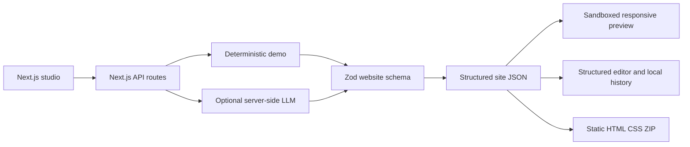

<div align="center">

# AI Website Generator 🪄

**Crie websites responsivos e editáveis com prompts estruturados e seguros.**

[🇺🇸 English](README.md) · [🇧🇷 Português](README.pt-BR.md) · [🇪🇸 Español](README.es.md)

[](https://github.com/RamonRDR/ai-website-generator/actions/workflows/ci.yml)
[](https://nodejs.org/)
[](https://www.typescriptlang.org/)
[](LICENSE)

[](https://nextjs.org/)
[](https://react.dev/)
[](https://zod.dev/)
[](https://stuk.github.io/jszip/)
[](docs/SECURITY.md)

[](https://vitest.dev/)
[](https://playwright.dev/)
[](https://testing-library.com/docs/react-testing-library/intro/)
[](https://github.com/testing-library/jest-dom)
[](https://eslint.org/)
[](https://prettier.io/)
[](tsconfig.json)
[](https://github.com/RamonRDR/ai-website-generator/actions/runs/42848221159)
[](docs/EVALUATION.md)
[](https://vite.dev/)
[](https://github.com/jsdom/jsdom)
[](https://github.com/vitejs/vite-plugin-react)

[](docs/EXPORT.md)
[](docs/architecture.md)
[](docs/SECURITY.md)

</div>

> **Status do projeto:** MVP implementado no [PR #1](https://github.com/RamonRDR/ai-website-generator/pull/1) (aberto para revisão, sem merge). A execução de referência [42848221159](https://github.com/RamonRDR/ai-website-generator/actions/runs/42848221159) foi aprovada. O badge CI acompanha a branch de desenvolvimento até o merge. Os cinco problemas apontados nas duas revisões do Codex foram corrigidos e testados; uma nova revisão está pendente. Não houve deploy.

## Visão geral

Studio em Next.js e TypeScript strict para criar websites a partir de descrições em linguagem natural. As páginas são **estruturas de dados validadas**, não código executável gerado por LLM. O projeto demonstra frontend, renderização segura, IA aplicada opcional, testes e exportação estática.

**O modo demonstrativo utiliza modelos determinísticos, não um LLM real.** O adaptador de IA ao vivo é opcional e ainda não foi validado com requisições pagas.

## Funcionalidades implementadas

- Sete categorias: empresarial, portfólio, institucional, produto, serviços, evento e restaurante.
- Campos de prompt, nome do projeto, público-alvo, objetivo, idioma, categoria e tema visual.
- Quatro temas: Ocean, Sunset, Forest e Mono, com cores hexadecimais editáveis e validadas.
- Schema Zod versionado e onze seções permitidas: `header`, `hero`, `features`, `about`, `services`, `pricing`, `testimonials`, `faq`, `cta`, `contact` e `footer`.
- Renderer HTML seguro, responsivo, com metadados e preview desktop/mobile (390 px) em iframe isolado.
- Editor por formulários para títulos, descrições, botões, links, cards, imagens permitidas, visibilidade, inclusão, exclusão e reordenação.
- Regeneração limitada à seção selecionada, com prévia e aceite ou rejeição explícita.
- Até 15 checkpoints locais no navegador, restauração e comparação básica com o último checkpoint.
- ZIP estático contendo `index.html`, `styles.css`, `metadata.json` e `README.md` de exportação.
- Adaptador opcional de chat completions da OpenAI, desativado por padrão e sem validação ao vivo declarada.

## Stack tecnológica

**Execução:** Node.js >=22.12.0; o CI utiliza Node.js **24**. **Aplicação:** Next.js **16.4.5**, React **19.3.1**, TypeScript **5.9.3** (strict), Zod **4.6.7** e JSZip **3.10.2**. **Testes:** Vitest **3.2.7**, Playwright **1.65.0**, React Testing Library **16.3.3**, jest-dom **6.9.1**, Vite **7.3.7**, Vite React plugin **5.2.0** e jsdom **27.4.0**. **Qualidade:** ESLint **9.39.5**, Prettier **3.9.10** e GitHub Actions.

As versões vêm do `package-lock.json`, não de suposições baseadas nos intervalos do `package.json`. Não foram implementados Tailwind CSS, banco de dados, Redis, Docker, servidor MCP ou deploy na nuvem.

## Arquitetura



`src/domain/schema.ts` define os limites de confiança. `src/domain/render.ts` escapa conteúdo e cria um layout fixo. O iframe não autoriza scripts. `src/domain/export.ts` utiliza apenas nomes de arquivos fixos; `src/domain/storage.ts` valida os sites salvos localmente. O provedor LLM opcional fica isolado em `src/server/provider.ts`. Veja [arquitetura](docs/architecture.md) e [decisões técnicas](docs/DECISIONS.md).

## Pré-requisitos

Node.js **22.12+**, npm e navegador moderno. O GitHub Actions utiliza Node 24. O modo demo não exige banco de dados, backend separado, conta na nuvem nem API paga.

## Instalação e configuração

```bash
git clone https://github.com/RamonRDR/ai-website-generator.git
cd ai-website-generator
npm ci
cp .env.example .env.local
npm run dev
```

O ambiente de exemplo é seguro para demonstração. No Windows PowerShell, se preferir, use `Copy-Item .env.example .env.local`. Para configurar intencionalmente o adaptador ao vivo, potencialmente pago, defina as variáveis **somente no servidor**:

```dotenv
LLM_ENABLED=true
LLM_API_KEY=your_private_server_key
LLM_MODEL=your_supported_json_schema_model
```

As chamadas utilizam o endpoint oficial e fixo HTTPS de chat completions da OpenAI e exigem modelo compatível com `json_schema`. Em produção, também é necessária a opção `LLM_ALLOW_PRODUCTION=true`. **Não disponibilize geração paga publicamente sem autenticação, quotas e rate limiting**; o MVP não implementa essas proteções.

## Execução e exemplo de uso

Depois de `npm run dev`, abra `http://localhost:3000`. Selecione **Demo · Free, deterministic**, informe o nome e a descrição do negócio, escolha categoria e tema e clique em **Generate website**. Alterne entre Desktop/Mobile, edite seções, salve checkpoints, proponha alterações, aceite/rejeite, restaure uma versão e exporte o ZIP.

Prompt de exemplo: “Crie um portfólio minimalista para um desenvolvedor web autônomo, com serviços e contato em destaque.” O modo demo usa conteúdo determinístico por categoria, **não geração semântica por IA real**. Mais exemplos: [biblioteca de prompts](docs/PROMPTS.md).

## Interface web e rotas API

- `GET /`: interface responsiva do Studio.
- `GET /api/health`: resposta simples de integridade da aplicação (não verifica banco de dados).
- `POST /api/generate`: geração validada via demo ou adaptador ao vivo explicitamente habilitado.
- `POST /api/regenerate`: proposta validada de regeneração da seção selecionada.

A API é interna à aplicação. **Não existem OpenAPI/Swagger UI**, autenticação SaaS pública nem serviço de API publicado externamente. Veja os [schemas](docs/SCHEMA.md).

## Testes automatizados

```bash
npm run lint
npm run typecheck
npm test
npm run evaluate
npm run build
npm run format:check
npx playwright install chromium
npm run test:e2e
```

**Confirmado na execução [42848221159](https://github.com/RamonRDR/ai-website-generator/actions/runs/42848221159):** 35/35 testes Vitest aprovados em 9 arquivos; 8/8 testes Playwright E2E aprovados; **0 falhas e 0 ignorados**. `npm run evaluate` executa novamente **um** teste já incluído nos 35. Ele valida **20 cenários sintéticos determinísticos**, não 20 testes adicionais nem desempenho de LLM real.

As quantidades são um **registro de CI**, não um contador automático. Quando os testes mudarem, atualize os mesmos números nos três READMEs e no [inventário de badges](docs/BADGES.md) a partir de uma execução aprovada. Não declare percentual de cobertura sem medição.

## GitHub Actions

`.github/workflows/ci.yml` usa runners Ubuntu do GitHub e permissões somente de leitura. O job de qualidade executa ESLint, tipagem TypeScript strict, Vitest, avaliação determinística, build Next.js e Prettier; o job de navegador executa Playwright/Chromium. A instalação é reproduzível via `npm ci` e lockfile. Não exige computador pessoal, API paga, deploy ou merge automático.

## Segurança

Schemas Zod restritos controlam componentes, URLs, imagens, textos, cores e tamanho dos prompts. O HTML é escapado; scripts/JSX e HTML bruto produzido por IA não são executados; o iframe é isolado; credenciais ficam no servidor; e nomes de arquivos ZIP não dependem de entrada do usuário. Respostas inválidas do modelo são rejeitadas. Mais detalhes: [modelo de segurança](docs/SECURITY.md).

## Limitações conhecidas

O modo demo usa templates; a operação paga de LLM real **não foi validada**. Não há editor drag-and-drop, sincronização entre dispositivos, colaboração multiusuário, autenticação, limitação pública de requisições, banco de dados, pagamentos ou deploy. O ZIP contém HTML/CSS estático, não um projeto Next.js completo. É necessária revisão humana de informações, direitos de imagens, acessibilidade e SEO. Não afirmamos certificação WCAG, cobertura de código medida, screenshots nem URL de produção.

## Estrutura do repositório

- `app/`: aplicação Next.js, página do Studio e rotas API.
- `src/domain/`: schemas, temas, demo, renderer, histórico e exportação.
- `src/server/`: adaptador opcional de IA no servidor.
- `src/ui/`: experiência responsiva de edição e preview.
- `tests/` e `e2e/`: testes unitários/de componentes, avaliação determinística e E2E Chromium.
- `docs/`: arquitetura, schemas, segurança, testes, avaliação, decisões e evidências dos badges.
- `.github/workflows/ci.yml`: validações automáticas sem deploy.

## Próximas evoluções possíveis

Evoluções opcionais: avaliação de provedor real autorizada, auditorias de acessibilidade, autenticação e rate limiting antes de expor IA paga, importação de projetos editáveis e edição visual mais avançada. **Nenhuma dessas propostas é anunciada como implementada.**

## Contribuições

Issues e pull requests específicos são bem-vindos. Antes de alterar, execute os testes e preserve o renderer estruturado e seguro. O projeto está em revisão no [PR #1](https://github.com/RamonRDR/ai-website-generator/pull/1); a branch `main` só será atualizada com aprovação do proprietário.

## Documentação

[architecture](docs/architecture.md) · [schemas](docs/SCHEMA.md) · [security](docs/SECURITY.md) · [tests](docs/TESTING.md) · [evaluation](docs/EVALUATION.md) · [prompt examples](docs/PROMPTS.md) · [export](docs/EXPORT.md) · [decisions](docs/DECISIONS.md) · [badge inventory](docs/BADGES.md)

## Licença

[Licença MIT](LICENSE) © 2026 Ramon Rodriguez.
