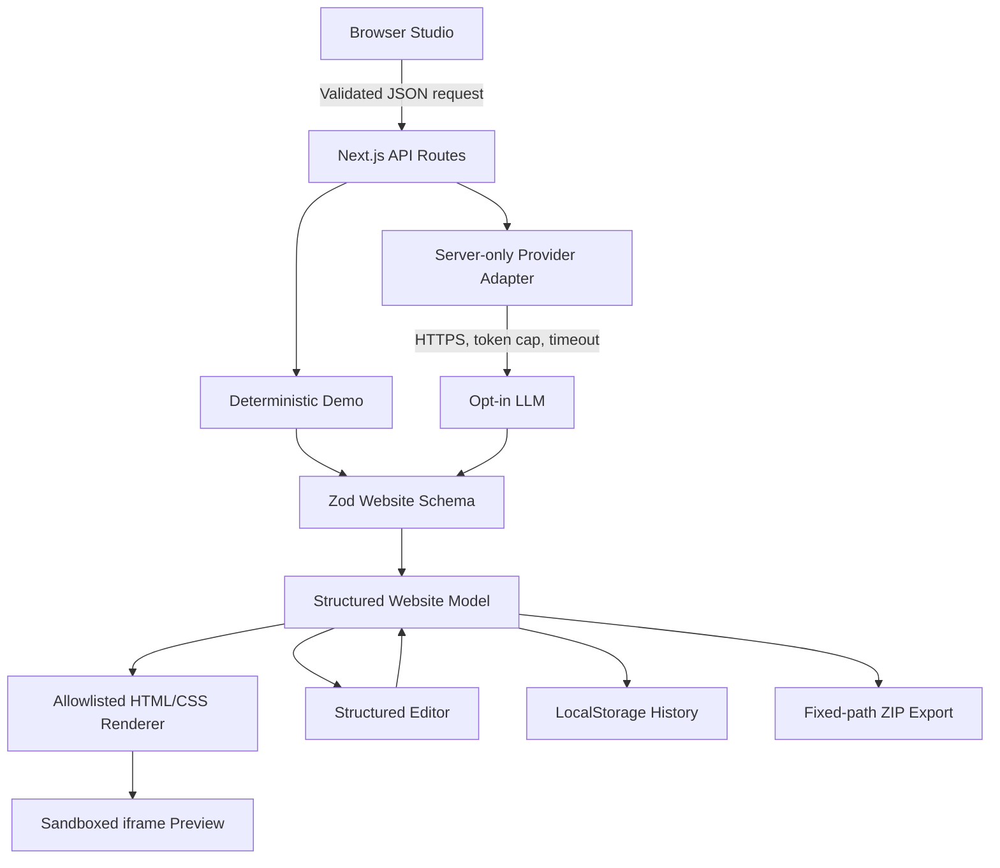

# Architecture

## Layers

- `app/`: Next.js App Router application and server endpoints; no separate backend.
- `src/domain/schema.ts`: Zod v1 schema, category/theme/section allowlists, URL and image restrictions.
- `src/domain/demo.ts`: deterministic demo generator and scoped regeneration.
- `src/domain/themes.ts`: approved initial palettes.
- `src/domain/render.ts`: safe HTML escaping and responsive CSS, shared between preview and export.
- `src/domain/export.ts`: constrained static export with fixed filenames only.
- `src/domain/storage.ts`: browser persistence schema and retention.
- `src/server/provider.ts`: strictly opt-in server-side LLM adapter with structured response and schema validation.
- `src/ui/GeneratorStudio.tsx`: all user interactions: generate, edit, preview, propose, accept/reject, version, restore, export.

## Trust boundaries

1. Prompts and request data are untrusted and validated in the API route before processing.
2. LLM output is untrusted JSON; only successful Zod parsing reaches the editor and renderer.
3. The renderer uses a fixed, known set of tags and HTML-escaped data; CSS variables are constrained to hex colors.
4. The iframe has the `sandbox` attribute without permissions. No scripts or generated code are run.
5. Static export uses a fixed mapping of filenames. No user-controlled paths, filesystem reads or publishing.
6. History data loaded from the browser is parsed again using the current schema.

## Versioning

Stored projects use `schemaVersion: 1`. No migration mechanism exists yet. Unknown/invalid older storage is discarded safely, not silently coerced.

## Scope

This MVP intentionally excludes free-form code execution, arbitrary HTML injection, production user accounts, server-side project databases, collaboration, billing and deployment. This makes the attack surface smaller and the system more straightforward to review.
